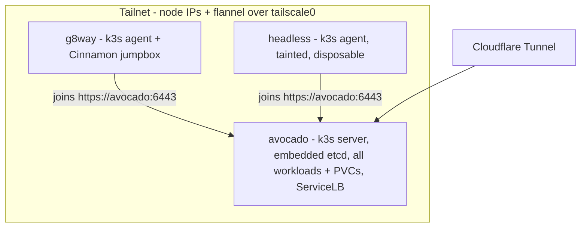

# Cluster nodes

The flake now defines **three NixOS hosts**. `avocado` is still the whole
show: the only k3s server and the home of every workload and PVC. `g8way` and
`headless` are k3s **agents** (workers), brought up one layer at a time.

{: .note }
> **Where things stand.** Both g8way and headless now run NixOS (installed
> with nixos-anywhere), with the sops (password) and Tailscale layers, and
> both are on the tailnet. g8way also has its desktop/jumpbox layer (Cinnamon,
> Home Manager, cluster tools + admin kubeconfig). Since 2026-11-04 both are
> **k3s agents** (tainted, opt-in only), and all three nodes talk over the
> tailnet. Details per phase [below](#phased-rollout).

## The hosts

| | `avocado` | `g8way` | `headless` |
|---|---|---|---|
| Role | k3s **server** (control plane, embedded etcd), all workloads + PVCs, kiosk | k3s **agent** + **jumpbox** (Cinnamon desktop, cluster tools) | k3s **agent**, **disposable** (no state, no display) |
| Hardware | Intel i7-8550U, UEFI | Intel NUC5i3RYB (i3-5010U 2C/4T), 16 GB | HP 348 G7 laptop (i3-8130U 2C/4T), 16 GB |
| Disk(s) | WD 120 GB + Crucial 250 GB SATA, ZFS **stripe** | Gigabyte GP-GSTFS31240GNTD 240 GB SATA SSD, single-disk ZFS | Samsung PM951 256 GB NVMe, single-disk ZFS, **SMART FAILED** |
| LAN NIC | `enp2s0` | `enp0s25` (Intel I218-V) | `enp1s0` (Realtek RTL8111) |
| MAC | not recorded | `94:c6:91:14:ea:af` | `38:22:e2:ed:12:21` |
| LAN IP (DHCP) | `192.168.165.202` | `192.168.165.36` | `192.168.165.200` |
| mDNS | `avocado-2.local` today (see [Networking](networking.md#mdns-avocadolocal)) | `g8way.local` (was `nuc.local` under Mint) | `headless.local` (was `minty.local` under Mint) |
| Tailnet | `avocado`, `100.123.72.40` | `g8way`, `100.67.66.5` (tagged). Mint's old `nuc` node (`100.91.248.99`) is stale; remove it from the admin console | `headless`, `100.82.118.4` (tagged) |
| sops | own age key at `/var/lib/sops-nix/key.txt`, `secrets/avocado.yaml` | SSH host key, `secrets/g8way.yaml` | SSH host key, `secrets/headless.yaml` |
| Previously | Ubuntu | Linux Mint, hostname `nuc` | Linux Mint, hostname `minty` |

Per-host details (BIOS, kernel modules, SMART numbers) live as comments in
each `hosts/<host>/{default,hardware,disko}.nix`.

### Finding a host on the LAN

The router can't do DHCP reservations, so LAN IPs may move. That's why the
MACs are recorded. To find a host again:

```sh
nmap -sn 192.168.165.0/24 | grep -i -B2 94:c6:91:14:ea:af   # g8way
nmap -sn 192.168.165.0/24 | grep -i -B2 38:22:e2:ed:12:21   # headless
```

Once a host is on Tailscale, use its MagicDNS name instead. It doesn't change
with DHCP.

### g8way notes

- **SMART healthy** at probe time (2026-11-04): 99% life left, 0
  reallocated/uncorrectable sectors. It has 4 old interface CRC errors from
  power-on hours 17–18, with none since. That points to a loose SATA
  connector, not the flash. Reseat it if the count grows.
- An LG 4K monitor ("LG HDR 4K") is attached. The NUC5's HDMI is **1.4**
  (4K at 30 Hz at best), so use **mini-DisplayPort** for 4K60. As of
  2026-11-04 it's on **HDMI** (`HDMI-A-2`), running 3840x2160 at 30 Hz. Moving
  the cable to mini-DP needs no config change.
- Its Intel 7265 Wi-Fi/BT works (firmware enabled), but the node uses
  Ethernet.

### g8way: desktop and jumpbox

g8way is the place to watch the cluster from: a Cinnamon desktop on the
attached monitor, plus the CLI tools over SSH.

- **Desktop:** Cinnamon on LightDM (`modules/desktop-cinnamon.nix`),
  PipeWire, Bluetooth/blueman, and NetworkManager through Cinnamon's network
  applet. Log in as `rithviknishad` with the sops-managed password. There's no
  autologin. The sleep targets are masked (`hosts/g8way/default.nix`), so the
  k3s node can never idle-suspend.
- **Graphics:** HD 5500 on the `modesetting` X driver, VA-API through iHD
  (`LIBVA_DRIVER_NAME=iHD`, `intel-vaapi-driver` kept as the i965 fallback).
  Check with `vainfo`.
- **Cluster access:** `modules/jumpbox.nix` installs `kubectl`, `k9s`,
  `stern`, `helm`, `helmfile`, `kubectx` and friends. It also decrypts
  avocado's admin kubeconfig (sops key `kubeconfig` in `secrets/g8way.yaml`,
  `server: https://avocado:6443` via MagicDNS) to `/run/secrets/kubeconfig`,
  with `KUBECONFIG` pointing at it in every session. `kubectl get nodes`
  works out of the box. Lens reads `~/.kube` by default, so add
  `/run/secrets/kubeconfig` in its kubeconfig settings.
- **Home Manager:** the same `home/rithviknishad` profile as avocado (zsh,
  kitty, Firefox, Zed, Lens, ...), which also puts the **personal SSH key** at
  `/run/secrets/rithviknishad/ssh_id_ed25519`. That's a deliberate tradeoff,
  see [Secrets](secrets.md#how-the-box-consumes-secrets).
- **nh:** imported, and the repo is cloned at `~/systems.nix` (as
  `rithviknishad`, over SSH with the sops key, 2026-11-04), so `/etc/nixos`
  resolves. GitHub's ed25519 host key was checked against its published
  fingerprint before going into `~/.ssh/known_hosts`. `nh os switch` on g8way
  builds **whatever is pushed and pulled**, so commit and push from avocado,
  then `git pull` on g8way first. The clone predates the g8way commits, so
  `nh os` there needs that pull. Day-2 deploys normally still go from
  avocado.

{: .note }
> **First switch to a desktop doesn't start it.** `nixos-rebuild switch`
> changes the default target to `graphical.target` but doesn't start it on a
> box that booted into multi-user. After the first desktop deploy, run
> `systemctl start display-manager` on the host (or reboot). Later switches
> are fine.

### headless notes

- **SMART FAILED**: 103% of rated endurance used, critical warning `0x04`
  (NVM subsystem reliability degraded), ~33k power-on hours. Spare is still
  100% with 0 media errors, so it isn't dying right now, but it can go at any
  time. The node is therefore **disposable**. When the disk dies, swap it and
  reinstall. There is nothing to restore. Monitoring acknowledges the failure
  and alerts only if it gets worse (see [Phase 4](#phase-4-monitoring)).
- It's a laptop running as a server. Its config ignores the lid switch in
  every power state and disables the `sleep`/`suspend`/`hibernate`/
  `hybrid-sleep` targets. Otherwise logind would suspend it on lid close,
  which takes the node off the network and looks exactly like a crash.

## Phased rollout

Each host is brought up in small layers, so a broken layer never costs a
reinstall.

| Phase | What | Status |
|---|---|---|
| 1 | Minimal NixOS via nixos-anywhere: SSH, ZFS, user, mDNS | **Done** on both |
| 2 | Layers: sops, password, Tailscale, (g8way) desktop + Home Manager + jumpbox tools | **Done** on both (g8way's desktop/jumpbox deployed 2026-11-04) |
| 3 | Join both as k3s agents over the tailnet (tainted, opt-in only) | **Done** 2026-11-04 (avocado needed a one-off `--cluster-reset`, see below) |
| 4 | Monitoring for the new nodes: host ZFS/SMART metrics, Vector logs, Gatus probes | **Done** 2026-11-04 |

### Phase 1: minimal install (done)

Both hosts were installed with nixos-anywhere, **building on avocado**
(`--build-on local`) and targeting their LAN IPs. headless
(`192.168.165.200`) went through first try. g8way (`192.168.165.36`) froze
at the kexec step on its first attempt. It needed a power cycle (the disk was
untouched) and went through with `--kexec-extra-flags "--kexec-syscall"`. See
[Deployment](deployment.md#install-pitfalls). Uploading the ~2.3 GiB closure from avocado took about 23 minutes, so
expect a long, quiet copy step.

The first generation has only `base`, `ssh`, `zfs`, `avahi` and the user. With
no sops, `rithviknishad` has **no password**: it's SSH-key only, and admin
work (deploys, anything needing root) goes through **root's key**. That's
why the user's `hashedPasswordFile` is wired in `modules/sops.nix` rather than
`users/rithviknishad.nix` (see [Secrets](secrets.md)).

### Phase 2: layers

1. **sops** (done on both). The host decrypts with its **SSH host key**
   (sops-nix's default), so there's no key to provision. After install, derive
   its age recipient, add it to `.sops.yaml` with a rule for
   `secrets/<hostname>.yaml`, and encrypt that file:
   ```sh
   ssh-keyscan -t ed25519 192.168.165.200 | ssh-to-age
   ```
   Each host gets **its own secrets file** with just what it needs (password
   hash, Tailscale auth key, k3s join token). It is not a recipient of
   `secrets/avocado.yaml`. Details on the
   [Secrets](secrets.md#per-host-recipients-and-files) page.
   `secrets/g8way.yaml` started as a re-encryption of `headless.yaml` (same
   three keys; the k3s token is the cluster's shared join token).
2. **Password via sops** (done on both). Importing `modules/sops.nix` wires
   `hashedPasswordFile`.
3. **Tailscale** (done on both, via `modules/tailscale.nix`). Both use a
   **tagged, reusable** auth key. `tailscaled-autoconnect` only runs once at
   activation, so if the key was dead at that point, run
   `systemctl restart tailscaled-autoconnect` on the host after fixing it.
   Remove Mint's stale `nuc` machine (`100.91.248.99`) from the tailnet
   admin console.
4. **g8way only:** the Cinnamon desktop, Home Manager, and jumpbox tools
   (`kubectl`, `k9s`, etc.) plus the admin kubeconfig, for watching the
   cluster from the attached monitor. Done, see
   [g8way: desktop and jumpbox](#g8way-desktop-and-jumpbox).

### Phase 3: join k3s over the tailnet

Configured in `modules/k3s-common.nix` (shared), `modules/k3s.nix` (server,
avocado) and `modules/k3s-agent.nix` (g8way, headless):

- **Every node advertises its Tailscale IPv4 as its node-ip** and runs
  flannel's VXLAN over **`tailscale0`** (`--flannel-iface`). Node addresses
  then survive LAN DHCP changes, and pod traffic between nodes is
  WireGuard-encrypted. `tailscale0` is already a trusted firewall interface,
  so no k3s ports need opening for node-to-node traffic.
- **The node-ip is written at start-up, not hardcoded.** An `ExecStartPre`
  waits (up to 120 s, then lets `Restart=always` retry) for `tailscale0`'s
  IPv4 and writes `node-ip: <ip>` to `/run/k3s/node-ip.yaml`, which k3s reads
  via `--config`. Two dead ends ruled this in:
  - `--flannel-iface` alone makes k3s derive the node-ip from the
    interface, but `tailscale0` also has an IPv6 address, and k3s then
    returns `v4,v6`: a dual-stack node in an IPv4-only cluster.
  - A hardcoded `100.x` per host breaks silently after a reinstall, because
    a fresh tailnet registration gets a fresh IP.
- **Tradeoff:** k3s, and therefore every workload, now needs `tailscaled` up
  with an address before it starts. If avocado boots with no internet and
  `tailscale0` never gets its IP, k3s keeps retrying instead of starting on
  the LAN.
- **Agents join `https://avocado:6443`** (MagicDNS; the API cert already
  carries `--tls-san=avocado`) with the shared `k3s/token` from their own
  `secrets/<host>.yaml`.
- **Moving avocado's node-ip** from its LAN address `192.168.165.202` to
  `100.123.72.40` is a live control-plane change. Pods that already exist
  keep flannel's old MTU (1450 vs 1230 over `tailscale0`'s 1280) until
  they're recreated. That only matters for cross-node traffic, which the
  opt-in taint keeps rare.

**Status: done (2026-11-04).** Rollout went: etcd snapshot
(`pre-tailnet-node-ip-avocado-1793787394`) and ZFS snapshots
(`rpool/{var,root}@pre-k3s-tailnet`), then deploy avocado, then deploy
headless and g8way. Afterwards all three nodes were `Ready` on their tailnet
IPs, the agents carried the taint, node-exporter ran on them, and test pods
on each agent resolved cluster DNS and pulled a 560 KB response from Gatus
on avocado (so the VXLAN-over-Tailscale MTU is fine).

{: .warning }
> **Changing a k3s server's node-ip needs `--cluster-reset`.** Contrary to
> what the k3s source suggested, k3s did **not** rewrite the etcd member's
> peer URL by itself. After the switch it looped on `this server is not a
> member of the etcd cluster. Found [...=https://192.168.165.202:2380],
> expect: ...=https://100.123.72.40:2380`, with the API down (running pods
> kept serving through their containerd shims). The fix for a
> **single-member** cluster: `systemctl stop k3s`, run the unit's exact
> `k3s server ...` command line once with `--cluster-reset` appended (it
> keeps all data, rewrites the membership to the current node-ip, backs up
> `server/tls`, and exits), then `systemctl start k3s`. Do the same if
> avocado's tailnet IP ever changes, e.g. after re-registering it with
> Tailscale. Take an etcd snapshot first.

### Phase 4: monitoring

Monitoring for g8way and headless (`k8s/monitoring/`, `modules/monitoring.nix`):

- **Host metrics.** Both import `modules/monitoring.nix`, so their ZFS pool
  health, snapshot coverage and SMART reach VictoriaMetrics through their
  node-exporter like avocado's do. Their `/home` and `/var` are tagged
  `auto-snapshot=true`, so `ZFSSnapshotsMissing`/`Stale` cover them too.
- **headless's disk.** It fails SMART **permanently**, so a plain
  SMART-health alert would page forever. Its serial is acknowledged
  (`systems.monitoring.smart.acknowledgedFailingSerials` in
  `hosts/headless/default.nix`), which `SmartDeviceUnhealthy` skips, while the
  NVMe health-log alerts (`SmartNvmeCriticalWarning`,
  `SmartNvmeMediaErrorsIncreasing`) still page if it gets worse. See
  [Monitoring](monitoring.md#smart-smart-vmrulesyaml).
- **Logs.** Vector tolerates the opt-in taint, so pod logs on the agents are
  shipped to VictoriaLogs too.
- **Uptime.** Gatus probes each agent's node-exporter by MagicDNS name (group
  `nodes`), which flags a dead or unreachable node in ~3 minutes. See
  [Monitoring](monitoring.md#uptime-gatus).
- **Node down.** No new rules needed: the chart's defaults already cover the
  agents (`KubeNodeNotReady`, `KubeNodeUnreachable`, `KubeletDown`, and
  `TargetDown` for their node-exporter), as do the node-exporter rules
  (`NodeSystemdServiceFailed`, filesystem space, ...).



*(Current state, since phase 3 on 2026-11-04.)*

## How scheduling works

Now that the agents have joined, the scheduler could place any pod on any node. One rule
keeps the current setup working unchanged: **the agents are tainted
`rithviknishad.dev/opt-in=true:NoSchedule`**, so nothing lands on them unless
it explicitly opts in. Every existing workload, including the `csaas-*`
stack that isn't managed from this repo, stays on avocado with **no manifest
changes**. That matters because some of them can't run anywhere else:

- **Images that exist only in avocado's containerd.** `zerodha-kite:latest`
  is Nix-built and preloaded via `services.k3s.images`
  (`modules/zerodha-kite.nix`), with no registry behind it. The `:local`
  images (CARE, TeleICU, onvif-console) are imported by the `*-images`
  recipes with `imagePullPolicy: Never`, so on another node they fail with
  `ErrImageNeverPull`.
- **local-path PVCs** are node-pinned to avocado through their PV's node
  affinity, so pods that mount them can only land there anyway.

To run something on an agent, give it the toleration plus a nodeSelector:

```yaml
spec:
  tolerations:
    - key: rithviknishad.dev/opt-in
      operator: Exists
      effect: NoSchedule
  nodeSelector:
    kubernetes.io/hostname: headless   # or g8way
```

Only stateless workloads with registry-pulled images belong there, and on
headless, only things that are fine to lose along with its disk.

What that means for the system pods:

- **ServiceLB stays on avocado.** The `svclb-*` DaemonSets only tolerate the
  control-plane and `CriticalAddonsOnly` taints, so they skip the agents.
  Traefik's 80/443 and Mailpit's hostPorts stay on avocado, where
  `cloudflared` and the tailnet expect them.
- **node-exporter runs everywhere.** It tolerates every `NoSchedule` taint,
  which is how the agents show up in metrics. vmagent scrapes it over the
  tailnet.
- **vector (logs) runs there too**, since phase 4 gave it a toleration for
  the opt-in taint, so agent pods' logs reach VictoriaLogs.
- Taints and labels from `--node-taint`/`--node-label` apply only when a node
  **first registers**. Change them on an existing node with `kubectl taint` /
  `kubectl label`.

## Install and recover

All recipes take `host=` / `addr=` overrides (see
[Deployment](deployment.md#targeting-another-host)). Default is avocado.

{: .warning }
> **Installing ERASES the target's disk** (disko). Run it only with explicit
> confirmation.

```sh
just host=g8way eval                                  # evaluate locally, no build
just host=<host> addr=<lan-ip> install              # recipe form (builds on the target)
```

- The actual installs ran nixos-anywhere directly from avocado with
  `--build-on local`, not `just install`, which builds on the target. g8way
  also needed `--kexec-extra-flags "--kexec-syscall"`. See
  [Deployment](deployment.md#install-pitfalls) for the full command.
- The installer connects as `root@<addr>`, so root on the source OS must
  accept your key. Otherwise run nixos-anywhere as your user with `--sudo`.
- Prefer the LAN IP over `.local` names (find it by MAC, above).

Day-2 deploys build on avocado and push the result. See
[Deployment](deployment.md#deploying-to-g8way-and-headless):

```sh
# from avocado
NIX_SSHOPTS="-o UserKnownHostsFile=/dev/null -o StrictHostKeyChecking=no -o ControlPath=none" \
  nixos-rebuild switch --flake .#headless --target-host root@192.168.165.200
```

{: .note }
> **SSH ControlMaster bug when running from avocado.** avocado's Home Manager
> SSH config enables `ControlMaster`. Connections can fail with
> `mm_send_fd: sendmsg: Message too long`. Disable multiplexing with
> `-o ControlPath=none`. See
> [Deployment](deployment.md#ssh-controlmaster-bug-on-avocado) for how that
> applies to each recipe.

**Recovery.**

- **headless dies:** replace the disk, reinstall with the commands above, and
  rejoin. Nothing to restore. Remove the dead node from the cluster
  (`kubectl delete node headless`) if it won't come back under the same name.
- **Any reinstall changes the SSH host key, and with it the host's age
  recipient.** Re-run `ssh-keyscan ... | ssh-to-age`, update the anchor in
  `.sops.yaml`, and `sops updatekeys secrets/<hostname>.yaml` *before*
  deploying the sops layer. Otherwise activation can't decrypt the password
  or Tailscale key. For g8way, also `sops updatekeys secrets/ssh_id_ed25519`
  (Home Manager's SSH key).
- **g8way dies:** same, but its `/home` (jumpbox user data) is lost with the
  disk. Keep anything important elsewhere.
- **Box unreachable by name:** find its IP by MAC, then use `addr=<ip>`.

## Risks

- **g8way holds the keys to everything.** It has cluster-admin
  (`kubeconfig`) and the personal SSH key (root on every host, GitHub) at
  rest, behind a desktop login on the LAN. If it's lost or compromised,
  rotate both (see [Secrets](secrets.md#how-the-box-consumes-secrets)).
- **headless's SSD is worn out** (SMART FAILED). Expect it to die. That's why
  it runs nothing stateful.
- **Every host has single-disk or striped storage, no redundancy.** g8way and
  headless each have one disk; avocado's pool is a stripe across two. Any
  disk failure loses that host's whole pool, OS included.
- **avocado is still a single point of failure.** It's the only k3s server
  (embedded etcd with one member) and holds every PVC. The agents add compute,
  not resilience. If avocado is down, the cluster is down.
- **Tailnet dependency (after phase 3).** Node traffic and flannel ride
  Tailscale, so a Tailscale outage on a node takes it out of the cluster.
