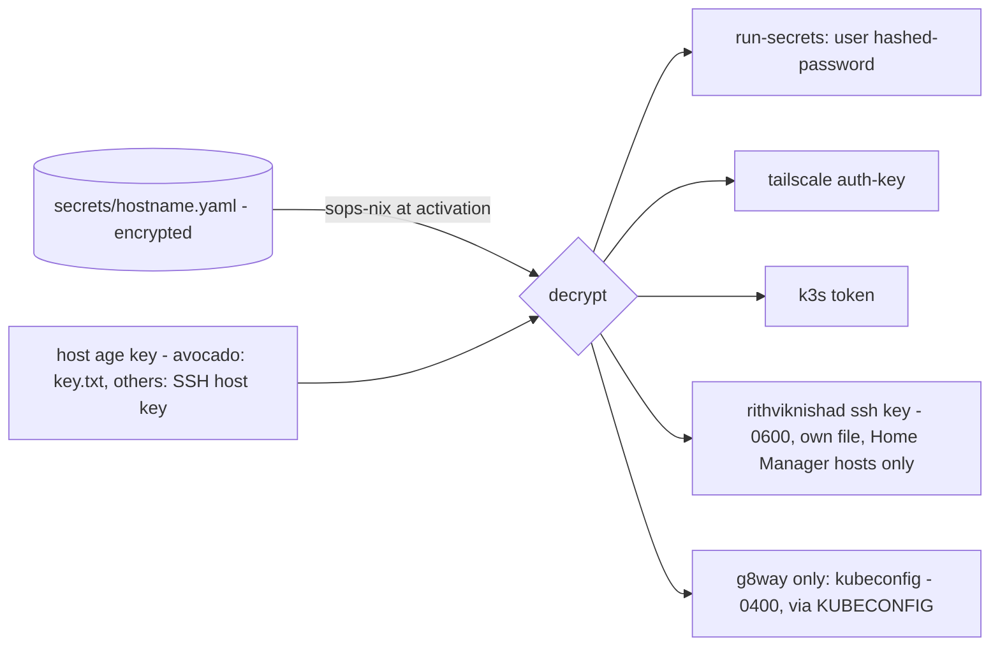

# Secrets: sops-nix

Every secret in this repo is committed **encrypted** with
[sops](https://github.com/getsops/sops) +
[age](https://github.com/FiloSottile/age), and decrypted only where it's needed.
Nothing sensitive ever lands in the repo (or in CI logs) as plaintext.

## The recipients

Defined in `.sops.yaml`. Each secret is encrypted to one or more **age
recipients**:

| Anchor | Key lives at | Role |
|---|---|---|
| `admin` | `~/.config/sops/age/keys.txt` (the Mac) | edit secrets locally |
| `avocado` | `/var/lib/sops-nix/key.txt` (the box) | decrypt at activation/boot |
| `headless` | derived from `/etc/ssh/ssh_host_ed25519_key` on headless | decrypt `secrets/headless.yaml` only |
| `g8way` | derived from `/etc/ssh/ssh_host_ed25519_key` on g8way | decrypt `secrets/g8way.yaml` + `secrets/ssh_id_ed25519` |

avocado's key is provisioned **out-of-band**, and it is never in the repo.
That's the whole point: the encrypted files are safe to commit because only the
box (or you) holds a key that can open them. The newer hosts use their SSH host
key instead (see [Per-host recipients and files](#per-host-recipients-and-files)).

## Which file is encrypted to whom

`creation_rules` in `.sops.yaml` map each path to its recipients:

| File | Recipients | Contents |
|---|---|---|
| `secrets/avocado.yaml` | admin + avocado | user password hash, Tailscale auth key, k3s token |
| `secrets/headless.yaml` | admin + headless | user password hash, Tailscale auth key, k3s join token |
| `secrets/g8way.yaml` | admin + g8way | user password hash, Tailscale auth key, k3s join token, `kubeconfig` (cluster admin kubeconfig for the [jumpbox](nodes.md#g8way-desktop-and-jumpbox)) |
| `secrets/ssh_id_ed25519` | admin + avocado + g8way | user's SSH private key (binary) |
| `secrets/cloudflared_credentials.json` | admin + avocado | tunnel credentials (binary) |
| `secrets/monitoring.enc.yaml` | admin + avocado | Grafana admin password, ntfy token |
| `secrets/care.enc.yaml` | admin + avocado | CARE k8s Secret: Django key, JWKS, Postgres, VersityGW root (`BUCKET_KEY`/`BUCKET_SECRET`), ABDM client id/secret |
| `secrets/care-teleicu.enc.yaml` | admin + avocado | TeleICU gateway k8s Secret: Django key, gateway JWKS, Postgres + S3 credentials |
| `secrets/kite.enc.yaml` | admin + avocado | Kite k8s Secret: JWT + encrypt keys, GitHub OAuth app id/secret, break-glass password |
| `settle-up-mcp.enc.yaml` | admin + avocado | Settle Up MCP k8s Secret: account email + password, live Firebase Web API key, MCP bearer token |
| `secrets/mailpit.enc.yaml` | admin + avocado | Mailpit k8s Secret: SMTP (`smtp-auth`) and web-inbox (`ui-auth`) password files |
| `secrets/care-box.enc.env` | admin + avocado | [CARE in a box](care-box.md) on lumine (dotenv): Django key, JWKS, VersityGW root, ABDM client id/secret, Mailpit password, `BOX_ADMIN_PASSWORD` |
| `secrets/lumine-cloudflared.json` | admin + avocado | lumine's own tunnel credentials (binary) |
| `secrets/care-box-backup_ed25519` | admin + avocado | SSH key avocado pulls care-box backups with (binary; locked to a forced command on the Pi) |

lumine (the Pi) is deliberately **not** a recipient of its own secrets.
avocado or the Mac decrypts them and streams the plaintext over SSH into
root-only files on the box (`just box-secrets-render`), so nothing on the Pi
can open anything in `secrets/`.

## How the box consumes secrets



`modules/sops.nix` is **host-agnostic**. It sets
`secrets/<networking.hostName>.yaml` as the default source, and each host
chooses how it decrypts. avocado sets `sops.age.keyFile =
/var/lib/sops-nix/key.txt` in `hosts/avocado/default.nix`. Every other host
keeps sops-nix's default, the age identity derived from its SSH host key. The
module then declares:

- **`users/rithviknishad/hashed-password`** — marked `neededForUsers` so it is
  decrypted early enough to create the account (before normal `/run/secrets` is
  mounted). Wired into the user via `hashedPasswordFile`. That wiring lives
  **here in `modules/sops.nix`**, not in `users/rithviknishad.nix`, so a host
  can import the user before it has a sops key (a fresh nixos-anywhere
  install). Such a host gets an SSH-key-only account, and root's key does the
  admin work until sops is layered on.

The user's SSH private key, **`rithviknishad/ssh_id_ed25519`**, is declared in
`modules/home-manager.nix`, next to its only consumer, the Home Manager
[ssh module](home-manager.md#ssh-client-ssh). It's its own binary sops file,
decrypted to `/run/secrets/...` owned by the user (mode `0600`). A host only
needs to be a recipient of `secrets/ssh_id_ed25519` once it runs Home Manager:
today that's avocado and g8way, not headless.

{: .warning }
> **The personal SSH key lives on g8way too.** Home Manager on the jumpbox
> needs it (`git` over SSH, hopping to other hosts), so g8way became a
> recipient. That's a real tradeoff: anyone who gets root on g8way, or its
> SSH host key, or its disk, gets the key, and with it everything it opens
> (GitHub, every host's root). If g8way is ever lost or compromised, rotate
> the key, drop `*g8way` from the `secrets/ssh_id_ed25519` rule, and
> `sops updatekeys` the file.

The jumpbox's **`kubeconfig`** (cluster-admin credentials for avocado's k3s,
`server: https://avocado:6443`) is declared in `modules/jumpbox.nix` and read
from the host's own file. It was added with `sops set --value-file`, the value
staged in `/dev/shm` and shredded, so it never touched the repo tree in
plaintext. It's cluster-admin, so the same compromise caveat applies; if the
k3s client cert is rotated, re-run that step.

Other modules declare the secrets they need the same way:
`tailscale/auth-key` ([tailscale.nix](networking.md)), `k3s/token`
([k3s.nix](kubernetes.md)), `kubeconfig`
([jumpbox.nix](nix-modules.md#jumpboxnix--cluster-tools--kubeconfig)), and
`cloudflared/credentials` ([cloudflared.nix](networking.md)).

## Editing secrets

Always work inside `nix develop` (it sets `SOPS_AGE_KEY_FILE`). The `justfile`
wraps the common operations:

```sh
just secrets            # edit secrets/avocado.yaml
just secrets-show       # print decrypted (mind your screen)
just secrets-rekey      # re-encrypt after changing recipients in .sops.yaml
just passwd             # generate a SHA-512 hash to paste in (mkpasswd -m sha-512)
```

There is also a parallel set of recipes for the helm values secret
(`just mon-secrets*`).

## Per-host recipients and files

Each host other than avocado decrypts with its **SSH host key**. There's
nothing to provision, but adding a host takes a few steps:

1. **Derive the recipient** once the host is installed:
   ```sh
   ssh-keyscan -t ed25519 <lan-ip> | ssh-to-age
   ```
2. **Add it to `.sops.yaml`** as an anchor, with a `creation_rule` for
   `secrets/<hostname>.yaml` that lists only `admin` + that host.
3. **Create the file** with just what the node needs: password hash, Tailscale
   auth key, k3s join token. headless's was seeded from `secrets/avocado.yaml`
   by decrypting into a tmpfs and re-encrypting, so no plaintext touched the
   repo tree.
4. Rekey existing files with `sops updatekeys secrets/<hostname>.yaml` when a
   recipient changes. `just secrets-rekey` only covers `secrets/avocado.yaml`.

No host is a recipient of another host's file. The new nodes can't read
`secrets/avocado.yaml`, which matters most for headless, a disposable laptop
whose disk may end up in a bin.

{: .warning }
> **A reinstall regenerates the SSH host key**, so the host's age recipient
> changes. Update its anchor in `.sops.yaml` and rekey its file *before*
> deploying, or activation can't decrypt the password and Tailscale key.

Current state:

| Host | Recipient in `.sops.yaml` | File |
|---|---|---|
| avocado | `avocado` (dedicated `key.txt`) | `secrets/avocado.yaml` |
| headless | `headless` (`age1c7p5g050...`) | `secrets/headless.yaml` |
| g8way | `g8way` (`age180mjswuz...`) | `secrets/g8way.yaml`, plus `secrets/ssh_id_ed25519` (Home Manager) |

### Tailscale auth keys

All three files carry the **same tagged, reusable** `tailscale/auth-key`
(tagged nodes' keys don't expire; see `modules/tailscale.nix`). The key is
only used to (re-)join, e.g. after a reinstall or if a node is removed from
the tailnet, so a revoked key is harmless until then. That's exactly when it
bites: an earlier key had silently been deleted on the Tailscale side, and
headless's first join failed with `invalid key: API key does not exist`. When
rotating it, update every host's file, redeploy, then run
`systemctl restart tailscaled-autoconnect` on any host that isn't connected,
because autoconnect doesn't retry on its own.

## Deploy-time decryption (helm stacks)

The Grafana admin password is **not** read by the box. Instead
`just mon-deploy` decrypts `secrets/monitoring.enc.yaml` into the gitignored
`k8s/monitoring/values-secret.yaml` on the admin machine, right before
`helmfile sync`, and it's never committed. See [Monitoring](monitoring.md).

It's a helm **values fragment** rather than a k8s Secret manifest, because helm
needs a file on disk rather than a stream — which is why it gets a gitignore
entry while every other workload pipes its decrypted Secret straight into
`kubectl`.
